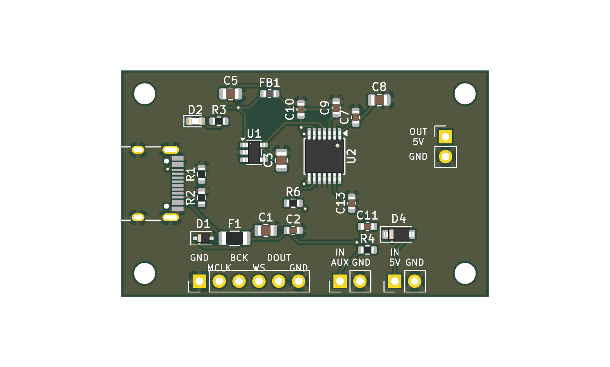

# I2SBoard

An add-on board for the [GuitarPreAmp](https://github.com/pschatzmann/GuitarPreAmp) or the [PiezoPreAmp](https://github.com/pschatzmann/PiezoPreAmp). It turns the preamp output into
**I2S** for an **ESP32** or **RP2040**, using a PCM1808 stereo ADC. The microcontroller provides the master clock (MCLK, BCK, WS).
A **USB-C** connector powers this board and the preamp.



## Features

- PCM1808, 24-bit, up to 96 kHz, slave mode (MCLK, BCK and WS from the microcontroller), I2S format
- The preamp signal goes to **both** channels (left and right carry the same signal), so either I2S slot can be used
- USB-C (power only) with 5.1k CC resistors, PTC fuse and ESD diode; the 5 V also powers the preamp
- Optional `5V IN` header for an external 5 V module (for example a LiPo charger/boost module)
- On-board 3.3 V LDO for the ADC's digital supply, and a ferrite-filtered 5 V for its analog supply
- **47 x 29 mm, the same outline and the same four mounting holes as the preamp boards**; the headers line up with the preamp's J2 and J3
- Signal from the preamp **AUX** output: wide bandwidth (about 9 Hz to 126 kHz)

## Connecting the preamp

The board takes the **AUX output** of the preamp (0 V centred, wide bandwidth, no 13 kHz filter) and powers the preamp. The two headers sit at the
same positions as the matching headers of the preamp boards, so the boards stack directly (M2.5 standoffs, same orientation):

| This board | Position (pin 1) | Preamp header | Signal |
|---|---|---|---|
| J1, 2 pins vertical | (41.5, 8.5) mm | pins 1-2 of J2 | `5V` (to the preamp), `GND` |
| J2, 2 pins horizontal | (28.0, 27.0) mm | J3 (AUX OUT) | `AUX` (from the preamp), `GND` |

Pins 3-4 of the preamp's J2 (OUT, GND) are not used. Use female sockets on J1 and J2 of this board (the preamp's J3 must be populated), or short
wires. The gain trimmer of the preamp is covered when stacked: set the gain before you stack the boards.

## Connecting the microcontroller (J3, bottom edge, 3.3 V logic)

| Pin | Signal | Direction |
|---|---|---|
| 1 | GND | |
| 2 | MCLK | microcontroller -> board |
| 3 | BCK | microcontroller -> board |
| 4 | WS (LRCK) | microcontroller -> board |
| 5 | DOUT | board -> microcontroller |
| 6 | GND | |

Connect the GND of the microcontroller. There is no power pin on this header: the board takes its power from USB-C (or J5).
Use fs = 48 kHz with MCLK = 12.288 MHz (256 fs) and BCK = 3.072 MHz (64 x fs), 24-bit I2S. The ADC auto-detects 256, 384 or 512 x fs.
The microcontroller must generate MCLK before it reads the data and keep it running. Wait about 2 s after power-up before using
samples: the coupling capacitors need about 1.7 s to settle.

### 16-bit or 24-bit data

The PCM1808 always outputs **24-bit I2S**, and it needs **64 BCK clocks per frame** (or 48 when MCLK is 384 x fs). A 32-BCK frame (16 bit slots)
is not supported. So each channel slot is 32 bits wide: the 24 data bits come first, MSB first, followed by padding. To get **16-bit** samples,
keep the clocks the same and read only the top 16 bits of each slot; no hardware change is needed.

- **ESP32:** set the data width to 16 bits and the slot width to 32 bits, so BCK stays at 64 x fs (3.072 MHz at 48 kHz). In ESP-IDF v5 that is
  `data_bit_width = 16` and `slot_bit_width = 32`. Alternatively read 32-bit words and shift them right by 16.
- **RP2040:** let the PIO program shift in 32 bits per channel and keep the upper 16 bits.

Reading 16 bits gives about 96 dB of dynamic range, slightly below the ADC's roughly 97 dB at 3 Vpp. For a guitar or piezo preamp that is usually
enough. Read the full 24 bits if you want to process the quiet end of the signal.

## Power

USB-C 5 V -> PTC (500 mA) -> 5 V rail -> preamp (J1 pin 1), 3.3 V LDO and the filtered analog 5 V. The LED shows that the rail is on.
`5V IN` (J5) feeds the same rail through a Schottky diode: use one source at a time. Never connect the 5 V of this board to a 3.3 V pin.

## Battery

There is no LiPo charger on this board on purpose (the boost converter would add switching noise next to the ADC, and the
design is not tested yet). Use a charger/boost module on `5V IN`.

## Simulation

The analog input and the power path were simulated with ngspice (`python3 tools/sim.py`, results in [sim/results.txt](sim/results.txt)).
Summary: -3 dB from 9.4 Hz to 126 kHz, 3.3 Vpp from the preamp becomes 2.70 Vpp at the ADC (no clipping from VCC 4.5 to 5.5 V), start-up
settling about 1.7 s, the ADC supply is 4.74 V or more even at the USB minimum of 4.75 V, hot-plug peak on the ADC supply 5.4 V (6.3 V in a
pessimistic model, limit 6.5 V). The PCM1808 itself, the I2S timing and the microcontroller are not simulated.

## Ordering from JLCPCB

Files are in [fab/](fab/): `I2SBoard_gerber.zip`, `BOM.csv`, `CPL.csv`.
1. Upload the Gerber zip, enable **PCB Assembly** (top side), add `BOM.csv` and `CPL.csv`.
2. In the 3D preview check the part rotations (PCM1808, SOT-23-5, USB-C, diodes).
3. Check stock and extended-part fees (the USB-C connector and the PCM1808 are probably extended parts).
4. Order the minimum quantity first, since the design is untested.
Headers (J1, J2, J3, J5) are not assembled; solder them yourself.

## Project files and regeneration

See [SPEC.md](SPEC.md) for the full specification and bill of materials. The KiCad files are generated from
[tools/design.py](tools/design.py):

```bash
cd tools
python3 gen_sch.py ../kicad/I2SBoard.kicad_sch   # schematic
./route.sh                                       # board, Freerouting, design-rule check
python3 export_jlc.py                            # fab/ files
python3 sim.py                                   # simulation
```

KiCad 9, Java and [Freerouting](https://github.com/freerouting/freerouting) at `~/tools/freerouting/freerouting.jar` are needed.
Freerouting is not deterministic, so run `route.sh` again if it leaves a connection open. After `route.sh`, check that
`kicad/I2SBoard.kicad_pro` has a default netclass clearance of 0.15 mm (the USB-C pads need it).

## Status

Untested design. The KiCad design-rule check (0 errors, 0 unconnected, silkscreen warnings only), the board outline, the mounting
holes and the J1 / J2 positions against the preamp boards, and the simulation above were checked. It has not been built or tested with an
ESP32 or RP2040.
